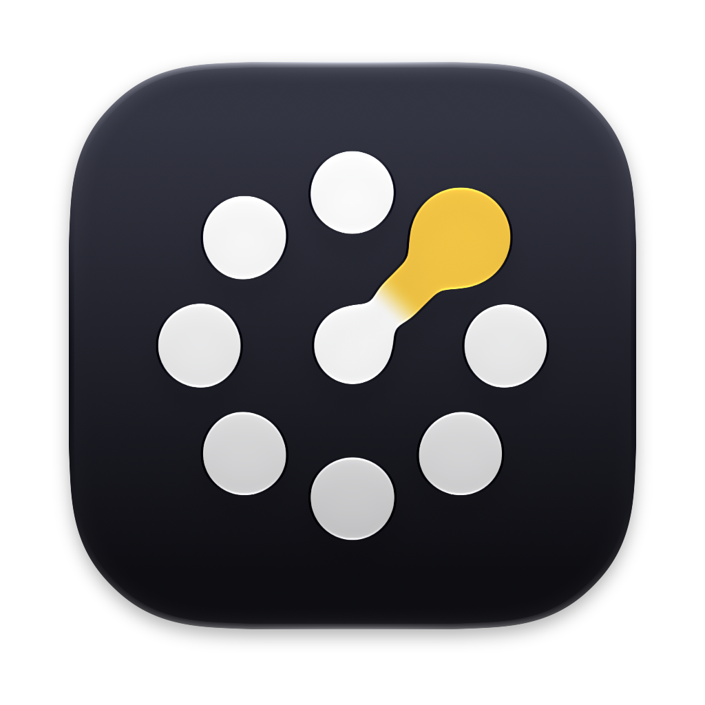

# Gooey Wheel

A native macOS radial actions menu for any mouse, modeled on the Logitech Actions Ring and given the liquid look of [Gooey](https://libraries.dev/gooey). Each bubble runs an action: a media key, a window layout, a system toggle, an app, a shortcut, a script. Some bubbles are controls in their own right, such as a volume bubble that turns into a slider.

## Run

```sh
./scripts/build-app.sh
open "build/Gooey Wheel.app"
```

Requires macOS 14 or later and the Swift toolchain from Xcode. The app has a menu bar item and no Dock icon.

The first launch shows a welcome panel: a video of the wheel in use and what the app does, then a page that asks which mouse button should open the wheel. While that page is up, pressing any mouse button other than the left and right buttons assigns it, and it offers Accessibility and Input Monitoring when reading a button needs them. The panel is drawn in goo like the editing panels, with a round button in each bottom corner: back on the left, and continue, then done, on the right. Return presses the right one, and Esc closes the panel. It arrives as a hub that throws out a ring of bubbles, takes them back, and spreads into the panel. Closing it draws it back in to a hub, and the wheel opens on that spot. Later launches open the wheel straight away. `--welcome` shows the panel again, and so does `defaults delete dev.gooey.wheel welcomed`.

The menu bar item has Open Wheel, Assign Button, Customize Wheel, Haptic Feedback, Dev Mode, Check for Updates…, and Quit Gooey Wheel. Assign Button shows the mouse button that opens the wheel; choosing it waits up to 15 seconds for a press and assigns whichever button is pressed, other than the left and right buttons. Customize Wheel opens the wheel in configuration. Haptic Feedback, shown only for a mouse with a haptic motor the app can drive, turns the wheel's taps through the mouse on or off.

Dev Mode swaps the wheel for the starter layout, which is planned to become the default. It starts over from the starter layout at every launch and each time Dev Mode is turned on, so changes made to it last until the next launch. It's kept in `Dev Mode/wheel.json` beside the saved wheel, which Dev Mode leaves alone and which comes back when Dev Mode is turned off. The setting is saved under the `devMode` default.

The starter layout puts the actions used most in the four straight directions: Mission Control up, Volume right, Screenshot down, and Previous App left. Up and left match the trackpad's swipe up for Mission Control and the usual left for back. The diagonals each show one kind of bubble for the first time: Media Controls (a picker), a Controls folder of toggles and Sound Output, a Windows folder of Move Window layouts that preview where the window goes, and Customize Wheel. Customize Wheel turns the open wheel into configuration, and its hub reads "Or right-click" to teach the shortcut that makes it unnecessary.

## Updates

The app updates itself from this repository's GitHub releases, through [Sparkle](https://sparkle-project.org). On the second launch Sparkle asks whether to check automatically, and then checks once a day. An update found by an automatic check doesn't open a window. Check for Updates… in the menu bar item reads "Update Available…" instead, with the new version under it on macOS 14.4 and later, and choosing it shows the release notes and installs. Otherwise Check for Updates… checks at once. It's dimmed while Sparkle is already checking or downloading.

The feed is `appcast.xml` on the latest release, at `https://github.com/gcrft123/gooey-wheel/releases/latest/download/appcast.xml`. Each archive in the appcast carries an EdDSA signature made with the key whose public half is `SUPublicEDKey` in the app's Info.plist, and the release script refuses to publish one without it. GitHub serves release files only for a public repository. Releases are built for Apple silicon only.

## Use

| Input | Result |
| --- | --- |
| Click the assigned mouse button | Opens the wheel and leaves it open |
| Hold the button, move toward a bubble, release | Picks that bubble. Releasing over nothing closes the wheel |
| Click a bubble | Picks it |
| Rest the cursor on a teardrop-shaped bubble | Opens that folder as a new ring around the bubble |
| Rest the cursor on the small parent ring, click the center, or press Esc | Goes back one level |
| Click outside the wheel, or press the button again | Closes |

Until a button is assigned, the wheel opens from the menu bar item, and on a Logitech mouse with a thumb button, from that button (see [Mouse button](#mouse-button)).

## Controls in bubbles

Some actions have a state, and their bubbles show it and change it in place.

| Kind | Actions | How it works |
| --- | --- | --- |
| Slider | Volume, Brightness, Keyboard Brightness, Pointer Speed | The level is drawn around the bubble's rim and read out in the hub. Scrolling over the bubble, with a mouse's scroll wheel or side wheel or with a trackpad, changes it a step at a time. Pressing on the bubble turns it into a bar under the cursor, and dragging along the bar sets the level; letting go turns it back. A click or a release of the button over it leaves the bar open, following the cursor, until the next click closes the wheel. Resting on the small parent ring, or Esc, goes back to the ring |
| Toggle | Mute, Mute Microphone, Do Not Disturb, Dark Mode, Keep Awake, Wi-Fi, Dock Hiding, Stage Manager, Precision Mode, Free Spin, Mouse Haptics, Natural Scrolling | The glyph shows the state and turns the accent color when on. The hub says On or Off. Choosing it flips it |
| Stepper | Undo, Zoom, Switch Tab | Scrolling over the bubble steps: up undoes and zooms in, down redoes, zooms out, and moves to the next tab. Choosing it does it once (Undo, Actual Size, Next Tab) |
| Picker | Media Controls, Sound Output, Microphone Input, Easy-Switch | Opens like a folder into choices read when it opens: the transport buttons with the track playing in the hub, the audio devices, the mouse's paired computers. The one in effect is lit. Media Controls stays open between presses |
| Readout | Mouse Battery | The hub shows the charge, and the glyph follows it |

Hovering a Move Window bubble shows where the front window would go, as a tinted outline on the screen.

A Previous App bubble shows the icon of the app it would bring forward, the one that was in front before the current app, and the hub names it. An icon chosen for the item replaces it.

An action this Mac or mouse can't run, such as Keyboard Brightness without a backlit Apple keyboard or Free Spin on a mouse without a free-spinning wheel, is shown faded, says so in the hub, and shakes its head when chosen.

### Mouse actions

Pointer Speed and Precision Mode change the sensor's resolution (DPI) on a Logitech mouse that lets it be set, and macOS's tracking speed for any other mouse. In tracking speed, Pointer Speed's slider covers the Tracking Speed slider in System Settings, choosing it steps through that slider's tick marks, and Precision Mode drops to a third of the speed, at most 0.5 on macOS's scale of 0 to 3. On a Logitech mouse Precision Mode drops to a third of the DPI, at most 400.

Mouse Battery reads the charge over HID++ from a Logitech mouse, from macOS for Apple's mice, and from the standard Bluetooth Battery service for other Bluetooth mice. That last one asks for Bluetooth permission the first time. A wired mouse, or one on another brand's receiver, has no reading.

Free Spin, Mouse Haptics, and Easy-Switch work on Logitech mice that have those features. Natural Scrolling is macOS's setting and works with any mouse.

The hub's label takes a second line when it is long, with the reading under the name.

After an action whose result isn't plain to see, a short message grows out of where the wheel's hub was: "Copied #3FA7D6" after Pick Color, "Microphone muted", "Ejected 2 disks", "Mouse switching to MacBook". An action that can't run says why in the same place, such as "Allow Accessibility for Gooey Wheel".

## Configure

Right-click a bubble or the center, or choose Customize Wheel in the menu bar item, to rearrange the wheel. The bubbles jiggle, the wheel stays open, and the cursor has to be on a bubble to act on it. Changes are saved as they are made, to `~/Library/Application Support/Gooey Wheel/wheel.json`.

| Input | Result |
| --- | --- |
| Click the X on a bubble | Removes it |
| Click the + in the center | Adds an item and opens its Action panel. Leaving the panel without saving drops the item again. The panel opens over the middle of the wheel. The + is dimmed when the ring is full: 8 items on the wheel, 6 in a folder |
| Drag a bubble along the ring | Moves it. A neighbor gives way once the bubble has passed its middle |
| Drag a bubble onto a folder | Puts it in the folder. Resting it there opens the folder, to place it |
| Drag a bubble onto another item | Makes a folder of the two and opens the folder's edit ring |
| In a folder, drag a bubble onto the small parent ring | Moves it out. Resting it there opens the parent ring, to place it |
| Click an item, or the pen on a folder | Opens its edit ring: Action, Color, Icon, Rename, and Remove. A folder has no Action. Remove takes the item off the wheel; the others open a panel. An edit ring picks by direction, like the wheel in normal use |
| Click a folder | Opens it |
| ⌘Z, ⇧⌘Z | Undoes and redoes changes made since configuration started |
| Esc | Steps back: out of a panel, a drag, an edit ring, or a folder, then out of configuration |
| Click outside the wheel | Closes an edit ring, or a panel with nothing changed. Otherwise ends configuration |
| Right-click | Ends configuration. The wheel stays open |

A folder that loses its last item is removed.

### Panels

An edit option turns into its panel, and the panel turns back into the option when it closes. Each panel has a back button. A save button appears once something has changed. Both are bubbles like the wheel's: they come out of the panel, fill under the cursor, and give when pressed.

| Panel | What it sets |
| --- | --- |
| Action | What the item does. Actions are listed by category on the left, with a search field. The right side holds what the chosen action needs: an app, a shortcut, a file or folder (drop one from Finder or type its path), a web address, a command or script, text, a key combination, one of a few options, or a level |
| Color | The item's color. Its glyph takes the color at rest, and its bubble fills with it when chosen. The wheel picks hue and saturation; the field takes any hex code. The first swatch is the default, and colors saved before are offered on a second row |
| Icon | Any SF Symbol, with search. The item's default icon is first, with a ring around it. Of the two round buttons beside the search field, the first switches to a list of installed apps, to use an app's icon, and back to the symbols. The second adds a picture from a file; while the item uses that picture, the button shows it. A picture is copied to `Icons` beside `wheel.json`, cropped to a rounded square if it has no transparency, and deleted at the next launch once no item uses it. App icons and pictures keep their own colors on the wheel |
| Rename | The item's name. An empty name goes back to the default, which is shown as the placeholder |

| Input | Result |
| --- | --- |
| Back button, or Esc | Drops the changes and returns to the edit ring |
| Save button | Saves the changes as one undo step and returns to the edit ring |
| Return | Saves if something changed, otherwise goes back. In a command, script, or text it starts a new line |
| ↑ ↓ | Move through a list or the icon grid |
| Tab | Moves between a panel's fields |
| Click outside | Closes the panel if nothing changed. Otherwise the save button jumps and the changes stay |
| ⌘Z in a field | Undoes typing |

While the key combination field is focused, it takes every key press before macOS and other apps can act on it, so a combination such as ⌘Space or ⌃→ is recorded instead of run. Esc on its own still goes back, and Delete on its own clears the field. This needs Accessibility; without it, combinations that macOS or another app has claimed run as usual.

An item with no name of its own is named after what its action is set to: the app, file, website, shortcut, or window layout.

A bubble is chosen by the direction of the cursor from the center, so the cursor doesn't have to reach it. A folder is the exception: it opens only once the cursor is on the bubble itself, so passing its direction on the way to something else doesn't open it.

While a folder is open, the ring it came from shrinks and dims in place, and the folder's items fan out away from it.

## Actions

Actions are listed by category in the Action panel, with a search field. Actions that take a setting show it on the right: a window layout or screenshot kind as tiles, a folder with one-click presets for the usual places, an app, a link, a key combination, text, a shortcut, or a script. [ACTIONS.md](ACTIONS.md) lists every action with its options and control.

Wheels saved by earlier versions are brought up to date when they load. Actions that were merged move to the action that replaced them: Volume Up, Volume Down and Set Volume to Volume, the thirteen window positions to Move Window, the four screenshot actions to Screenshot, the folder shortcuts to Open Folder, and so on. Retired actions with no equivalent, such as Scroll Up or Left Click, keep their name and wait for a new action.

macOS asks for some permissions the first time an action needs them. Key combinations, typing, window moves, and the menu-driven system actions need Accessibility; the menu bar item offers "Allow Accessibility for Actions…" while it is missing. New Finder Window asks to control Finder. Do Not Disturb's state can only be read with Full Disk Access; without it the toggle still works but shows no state.

A few actions use private macOS interfaces, loaded at run time so that a missing one disables its action instead of crashing the app: Mission Control and the Dock through `CoreDockSendNotification`, Dark Mode through SkyLight, brightness through DisplayServices, and Lock Screen and Switch User through the login framework. System shortcuts the user has turned off, such as the screenshot keys, are lent a spare key combination for an instant and then given back. A lent shortcut left behind by a crash is restored at the next launch.

The track playing is read from MediaRemote, which macOS 15.4 and later only answers for Apple's own processes. A small helper library loaded into `/usr/bin/perl` reads it, after [mediaremote-adapter](https://github.com/ungive/mediaremote-adapter). Without it the media keys still work and the track isn't shown.

## Mouse button

Any mouse button other than the left and right buttons can open the wheel. Assign Button waits for a press and assigns that button, which then stops doing what it did before.

The app reads the button from the events macOS makes of it. macOS numbers the buttons: 2 is the middle button, and the side buttons follow, usually 3 for back and 4 for forward. An event tap takes the assigned button's presses and releases out of the event stream before any app sees them, and turns its drags into plain pointer moves. The tap needs Accessibility. Until it's allowed, the menu bar item shows "Allow Accessibility…" in place of Assign Button, and the button starts working within a couple of seconds of allowing it. The choice is saved under the `mouseButton` default as the button's number.

### Logitech mice

A Logitech mouse that speaks Logitech's HID++ protocol is also read from the mouse itself. That reaches buttons macOS never sees, such as the MX Master 4's thumb panel, which opens the wheel until another button is assigned. The app doesn't use Logi Options+ and works whether or not Options+ is running. The mouse can be connected by Bluetooth or through a Logi Bolt receiver, and Easy-Switching between the two keeps the button working.

macOS requires Input Monitoring permission to open a Logitech mouse. Allow Gooey Wheel under System Settings → Privacy & Security → Input Monitoring, or choose "Allow Input Monitoring…" in the menu bar item, which shows it in place of Assign Button until it's allowed while a Logitech button is assigned. The button starts working within a couple of seconds of allowing it.

With such a mouse connected, Assign Button also asks it to divert every button it allows, except the left and right buttons, until one is pressed, and then hands them back. Those buttons do nothing else for that moment. A button pressed on the Logitech mouse is saved under the `button` default as its HID++ control ID. A button the mouse doesn't let the app divert is read through the event tap like any other mouse's.

Through a Bolt receiver, the app opens the receiver's HID++ interface and reaches the mouse by its slot on the receiver. The receiver announces when the mouse's link comes up or goes down, such as when the mouse wakes or is switched to another computer, and the app sets the button up again each time it comes back.

On Bluetooth, the mouse sends its button messages over two channels: HID reports, which the app opens, and a Bluetooth characteristic of Logitech's own, which Options+ uses. It sends them only to whichever channel last sent it a request. Options+ sends one every 4 seconds, so while it runs, the button's presses arrive on its channel for a second or two after each. The app listens on that channel too, which needs Bluetooth permission; macOS asks for it the first time the app opens. The only thing it writes there is haptic taps, while Options+ runs (see below).

After a pause of a second or more, the mouse sometimes never reports the release of the press before it. A press reported while the button still reads as down, after the mouse has been quiet for a while, counts as that missing release followed by a new press.

If Options+ is running and has the thumb panel assigned to its own Actions Ring in an app profile, both will open in that app. Set the panel to "Do nothing" in that profile.

`defaults write dev.gooey.wheel TriggerDebug -bool YES` turns on a diagnostic log at `~/Library/Logs/Gooey Wheel/trigger.log`. It records each press the event tap reads, every message from a Logitech mouse on both channels, what each press did to the wheel, clicks, app switches, and main-thread stalls. `defaults delete dev.gooey.wheel TriggerDebug` turns it off.

## Haptic feedback

A mouse with a haptic motor taps when the pointer moves onto a bubble, a folder, picker, or slider opens, a ring closes back to its parent, an item is chosen, or something can't be done. Opening a ring and choosing a bubble's action give a light tap, and choosing in a picker a firmer one. Sliders and steppers don't tap. Configuration mode taps for picking up, dropping, adding, and removing bubbles. The app drives one kind of motor, the one in Logitech mice with HID++ feature `0x19B0`. In November 2026 that's the MX Master 4 and its Special and Developer Editions. The G Pro X2 Superstrike's haptic clicks use a different feature and can't play taps. Each mouse reports which waveforms it has, and each tap uses the closest one it has. Other mice give no taps. A Force Touch trackpad taps for the same things, except rings opening and closing, whatever the mouse.

Taps are on by default. The menu bar item's "Haptic Feedback" turns them off and only shows while such a mouse is connected. The mouse's own haptics switch, which the Mouse Haptics action flips, has to be on too. Each tap is a HID++ request, and the mouse sends its notifications, scrolling included, to whichever channel sent the last request. So while Logi Options+'s background agent runs (it keeps running after Options+ is quit), taps go over Options+'s own Bluetooth channel, written without response the way Options+ writes, and Options+ keeps the scroll wheel. Without Bluetooth permission there are then no taps.

## How it's built

- `GooRenderer.swift` draws every shape in one Metal fragment shader as a signed distance field. Shapes are joined with an exponential smooth minimum, which makes them neck, bridge, and pinch off. Color uses the same weights, so the accent tint flows through a bridge. The shadow and rim light are computed from the same field.
- `WheelSim.swift` holds the motion. Each ring is a `Level` with its own hub, and open folders stack as levels. Every animated value is a closed-form damped spring (`Spring.swift`), so a new target keeps the current velocity and the motion is the same at 60 and 120 Hz. Spring constants are in `Tuning.swift`.
- `WheelItem.swift` and `WheelStore.swift` hold the wheel's contents: items with stable ids, saved as JSON, with undo. The sim keeps one bubble per item id, so a ring that gains, loses, or reorders items re-spaces along its circle.
- `WheelSim+Configure.swift` is configuration: what the cursor is on, presses, adding and removing, the jiggle, and the badges. `WheelSim+Drag.swift` is dragging. An edit ring is a `Level` whose hub is the item and whose bubbles are `EditOption`s.
- `WheelSim+Editor.swift` is a panel's shape and motion: the bubble that grows into it, the back and save buttons, and what the cursor is on. The renderer cuts the buttons' corners out of the panel's box with a smooth maximum, and a `firm` blob's field falls off faster outside it, which keeps a clean gap between the panel and its buttons where the rest of the goo would fuse.
- `EditorHost.swift` lays a panel's AppKit views over the goo panel, clipped to the same outline, and fades them in once it is most of the way open. `EditorContent.swift` is what the four panels share: each edits a copy of the item and writes it back on save. The panels are `ActionEditor.swift` (with `ParameterEditors.swift` for each kind of setting), `ColorEditor.swift`, `IconEditor.swift`, and `RenameEditor.swift`. `ItemIcon.swift` reads an item's icon, which is saved as an SF Symbol's name, `app:` and a bundle identifier, or `image:` and a picture's path, and saves pictures added in the Icon panel. `EditorList.swift` is the list they share and `EditorFields.swift` the fields. Lists, the icon grid, and the controls are stepped each frame on the same springs as the wheel, and their highlights glide from one row or cell to the next.
- `WheelLayers.swift` draws icons and labels as Core Animation layers above the goo. The Metal drawable is presented inside the same transaction that moves those layers, so they stay on the same frame.
- `WheelController.swift` owns the overlay panel and the display link. The panel doesn't activate the app, so the frontmost app keeps focus. Nothing renders while the wheel is closed, and a settled wheel skips identical frames.
- `WelcomePanel.swift` is the first launch's panel: its window, its two pages, the turn between them, and the gradient, a blurred mesh of color patches with film grain drawn once when the panel opens. `WelcomeGoo.swift` draws the panel's body and corner buttons with the wheel's renderer and springs, and steps its way in and out. The contents are clipped to the body with a mask computed from the same distance field as the shader's, so they follow the buttons' cutouts as those open.
- `MouseButtonTap.swift` reads the assigned button of any mouse through an event tap, and takes its events out of the stream.
- `KeyCapture.swift` is the event tap the key combination field uses while it is focused. It takes key presses out of the stream before the window server matches them against system shortcuts and other apps' hotkeys.
- `LogiButton.swift` asks a Logitech mouse to divert the assigned button (the thumb panel is control `0x01A0`) and listens for its press and release notifications. It also lists the mouse's buttons and diverts them all for a moment to find the one pressed for Assign Button. `ButtonTracker` merges the two reports the mouse sends for each change and recovers releases it drops. `VendorChannel.swift` listens for the same notifications on Logitech's Bluetooth characteristic. `LogiReceiver.swift` finds devices behind a Bolt receiver from its connection notifications, and `HIDPPPort.swift` is the opened HID interface that a Bluetooth mouse has alone and a receiver's devices share.
- `Actions/` holds what the bubbles do. `ActionRuntime.swift` defines an action's behavior: what choosing it does, and for a control its state, level, steps, or choices. Each category's actions are in their own file, such as `AudioActions.swift`, `WindowActions.swift`, and `SystemActions.swift`. `ActionRunner.swift` runs a chosen item, waiting for the wheel to leave the screen first when the action captures or covers it, and answers the wheel's questions about state. `KeySender.swift` posts key combinations, media keys, and text, finding keys by the character they type in the current keyboard layout. `MouseActions.swift` holds the mouse's settings, with `TrackingSpeed.swift` and `MouseBattery.swift` for mice that don't speak HID++.
- `WheelSim+Controls.swift` is the wheel's side of the controls: the state it last read for each item, scrolling, a slider's bar, and pickers. A bar is a `Level` whose hub is the bar; a picker is a `Level` whose bubbles are the choices.
- `Updater.swift` starts Sparkle's updater and owns the Check for Updates menu item. Sparkle is a binary target in `Package.swift`, taken from the release zip Sparkle publishes for SwiftPM.
- `HotKey.swift` registers Esc through Carbon while the wheel is open, which needs no Accessibility permission.

## Checking the actions

`GooeyWheel --self-test [pattern]` checks the actions against the Mac it runs on and prints one line per check, PASS, FAIL, or SKIP with the reason. It doesn't disturb whoever is using the Mac. Key presses go to a hidden window of its own, window actions move a hidden window of its own, settings are written back with the value they already have, the clipboard is put back, and an action whose effect would be visible is checked up to the point where it would act. The pattern is a regular expression over the checks' names, such as `audio|media`.

`GooeyWheel --run-action <id> [argument]` runs one action as the wheel would, for checking it by hand. `GooeyWheel --toast-preview <folder>` shows a few sample messages in the bottom-right corner of the screen and writes images of them into the folder.

## Releasing

```sh
./scripts/release.sh 1.2.0 notes.md
```

The script builds the app signed with the Developer ID Application certificate, with the hardened runtime, notarizes and staples it, and publishes release `v1.2.0` with two files: `Gooey-Wheel-1.2.0.zip` and an `appcast.xml` that lists it and the two versions before it, taken from the previous release's appcast. The release is a draft until both files are uploaded, so the latest release always has an appcast.

`notes.md` starts with the release's title as a heading, `# v1.2.0: What changed`. The rest is the release notes, shown on the GitHub release and, as Markdown, in the app's update window. `--dry-run` after the notes stops before publishing, leaving the files in `build/release/1.2.0/feed`.

The version users see comes from the argument. The build number Sparkle compares is the number of commits on `HEAD`, so a release has to be cut from `main`, and the script refuses one that isn't newer than the latest release before it builds anything. A run that fails after creating the draft leaves it in place, and the next run says how to remove it. `scripts/build-app.sh` takes the version from `GOOEY_VERSION`, or the newest `v*` tag, and the certificate from `GOOEY_SIGN_IDENTITY`.

It needs:

- The Sparkle signing key in the login keychain under the account `dev.gooey.wheel`. `generate_keys --account dev.gooey.wheel -x <file>` exports it for another Mac, and `-f <file>` imports it there. The tools are in `.build/artifacts/*/Sparkle/bin` after a build. A lost key can't be replaced without shipping a build with a new public key first.
- A notarytool keychain profile, made once with `xcrun notarytool store-credentials notarytool`. `GOOEY_NOTARY_PROFILE` names another profile. `GOOEY_SKIP_NOTARIZE=1` publishes without notarizing; Sparkle still installs that release, but Gatekeeper won't open a fresh download of it.
- `gh`, signed in with access to the repository.

## Recording a demo

`--demo` runs a scripted cursor on an opaque backdrop, which is useful for screen recordings and for tuning in slow motion.

```sh
.build/out/Products/Release/GooeyWheel --demo --stage color --timescale 0.25
```

`--stage` takes `dark`, `light`, or `color`. `--appearance light|dark` overrides the system appearance. `--demo-exit` quits after one pass. `--reduce-motion` shows the Reduce Motion version.

The stage is in the bottom-right corner of the main display, so a demo stays out of the way of whoever is using the Mac. `--demo-stage-rect` prints its rectangle in the form `screencapture -R` takes: `1700,780,836,636` for the default script and `1460,600,1076,816` for the configuration script on a 2560 × 1440 display. A demo doesn't take the Esc key.

`--demo-script configure` plays configuration instead: removing, adding, each panel, and dragging, on a larger stage. The demo uses the default wheel and saves nothing. Its app list shows only the apps that come with macOS, and its shortcut list is made up. Inside the panels the script works the views themselves: its clicks, drags, and key presses are sent through the demo's own window, the way the system delivers real ones, and never touch the real pointer or keyboard. `--demo-marks` lists the script's named moments with their times, and `--demo-stop-at <time>` freezes the demo at one of them. `--demo-root-count <n>` starts with only the first n items on the wheel, and `--demo-starter` starts with the starter layout.

`--demo-script controls` plays the controls in bubbles: a slider's rim, scrolling it, its bar, a toggle, and a picker. The demo's states are made up, so it never reads or changes this Mac's settings.

`--demo-script tour` plays a bit of everything in 23 seconds and starts and ends with the wheel closed. It's the welcome panel's video: `scripts/render-welcome-video.sh` captures it on `--stage clear`, which has no backdrop, with `--accent "#FFFFFF"` in place of the system's accent color so highlights show on the panel's yellow, and encodes it as HEVC with alpha to `assets/welcome.mov`. `--welcome-preview <folder>` writes images of the welcome panel's pages without showing it, and `--welcome-record <folder>` writes the whole panel frame by frame, from its way in to its way out, with a drawn pointer pressing its buttons.

`--demo-capture <folder>` writes an image of every named moment into a folder and quits, without showing anything: the demo's window is the stage alone, placed behind the desktop picture, and each image is a capture of that one window. `--demo-capture-filter <pattern>` limits it to the moments whose names match. `--demo-capture-frames <from>,<to>,<rate>` writes that stretch of the script frame by frame instead, for making a video.
